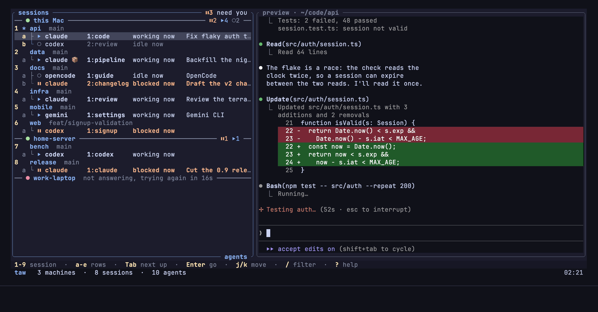
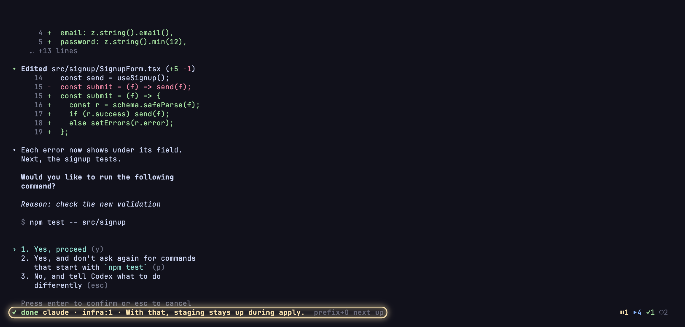
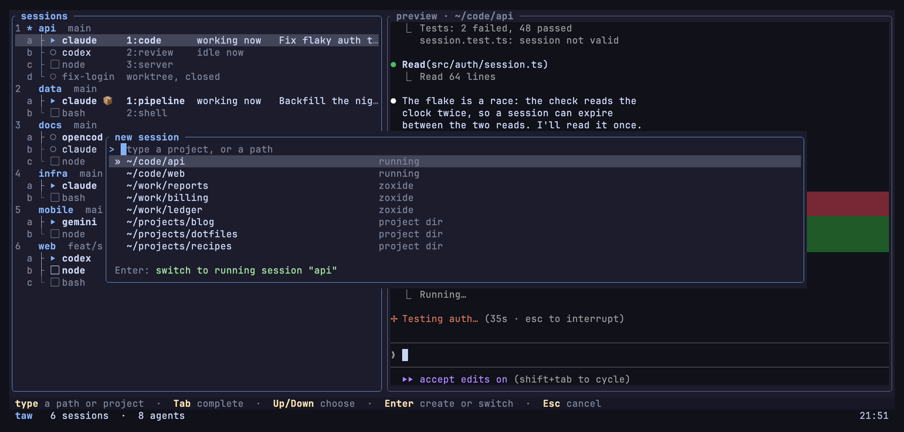
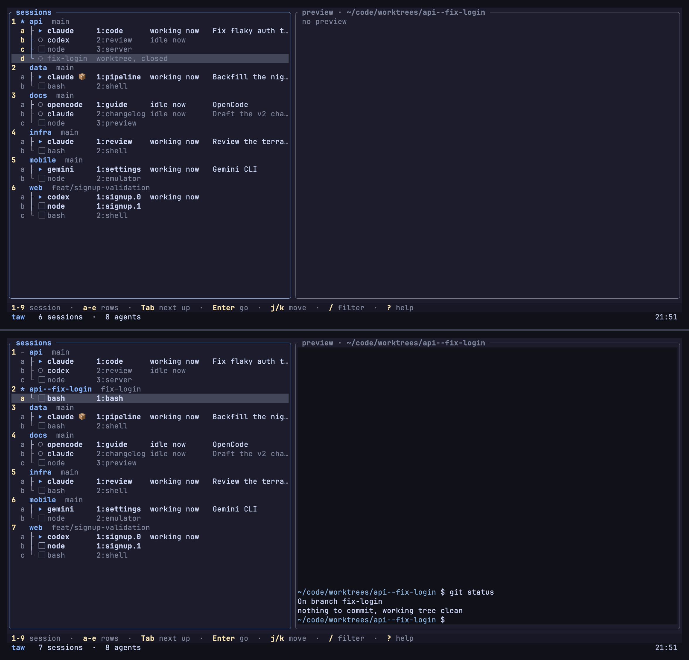

<div class="taw-hero" markdown>

<p class="taw-eyebrow"> tmux-agent-wizard</p>

# Every agent. One key. <span class="taw-line">Your tmux.</span>

<p class="taw-lede">See which coding agent needs you and get there in one key, inside the tmux
you already run.</p>

<div class="taw-actions" markdown>

[Try it in your browser](#try){ .md-button .md-button--primary }
[Install](install.md){ .md-button }

</div>

<p class="taw-facts">From the maker of <a href="https://github.com/27medkamal/tmux-session-wizard">tmux-session-wizard</a>.
<span class="taw-links"><a href="#how-it-compares">How it compares</a> · <a href="faq/">Questions</a> · <a href="https://github.com/27medkamal/tmux-agent-wizard">GitHub</a></span>
<span>tmux 3.2 or newer · macOS and Linux · MIT licence</span></p>

<div class="taw-try taw-hero-try" id="try">
<iframe src="try/index.html?embed=1" title="Try taw in your browser" width="100%" height="780" style="border:0"></iframe>

</div>

</div>

<div class="taw-highlights" markdown>

<div markdown>

<p class="taw-hl-head">Who needs you, in one key</p>

`prefix + A` shows every session and agent in one tree. `Tab` finds the one that needs you,
`Enter` goes there.

</div>

<div markdown>

<p class="taw-hl-head">Told wherever you are</p>

A toast in tmux, a desktop notification, or a message on your phone. `prefix + O` jumps to the
agent from anywhere.

</div>

<div markdown>

<p class="taw-hl-head">Back after a reboot</p>

Sessions, windows, layouts and folders, and 18 agents back in the same conversation.

</div>

<div markdown>

<p class="taw-hl-head">Your tmux, kept</p>

One plugin line, no restart. Your `tmux.conf`, keys and plugins stay, and agents already running
show up at once.

</div>

</div>

## Install

Needs tmux 3.2 or newer, on macOS or Linux, and [TPM](https://github.com/tmux-plugins/tpm).

1. Add the plugin to `~/.tmux.conf`:

    ```tmux title="~/.tmux.conf"
    set -g @plugin '27medkamal/tmux-agent-wizard'
    ```

2. Press `prefix + I`. TPM installs the plugin, and its first load downloads the `taw` binary
    for your machine from the project's
    [GitHub releases](https://github.com/27medkamal/tmux-agent-wizard/releases), checked against
    the release's SHA-256 checksum. tmux says `tmux-agent-wizard: taw is ready, press prefix + A`
    when it is done.
3. Press `prefix + A`. The agents you already have running are in the list.
4. Optional, for restore: once for each agent you use, let it tell taw its session, so a restore
    brings it back into the same conversation:

    ```sh
    taw integration install claude    # and codex, opencode, cursor, ...
    ```

5. Optional, for a shell outside tmux (inside tmux, `taw` is on your `PATH` already):

    ```sh
    mkdir -p ~/.local/bin && ln -s ~/.local/state/tmux-agent-wizard/bin/taw ~/.local/bin/taw
    ```

Without TPM, from source, or with the download or the per-pane watchers off: see [Install](install.md).

## Three keys

<div class="taw-keys" markdown>

<div class="taw-step" markdown>

<p class="taw-step-head"><span class="taw-step-n">1</span><span class="taw-key">prefix + A</span></p>

One tree: every tmux session, the panes under it and the worktrees whose session you
closed. Each agent shows its state, its task and how long it has been that way. The
border counts what needs you.

</div>

<div class="taw-step" markdown>

<p class="taw-step-head"><span class="taw-step-n">2</span><span class="taw-key">Tab</span></p>

Moves the cursor to who to deal with next: the next agent that needs you (blocked, or
finished and not looked at yet), else the next agent of any kind.

</div>

<div class="taw-step" markdown>

<p class="taw-step-head"><span class="taw-step-n">3</span><span class="taw-key">Enter</span></p>

Goes there.

</div>

</div>

`1`-`9` jump to a session, `a`-`e` to its rows, `/` filters the whole tree with fzf
syntax, matching only what its rows show, and the preview shows the pane under the cursor. The bottom line names the keys you
need most; `?` lists every key on one screen. If you know tmux, you already know taw.
[All the keys](keys.md)

<figure class="taw-shot taw-window">
  <div class="taw-window-bar" aria-hidden="true"><i></i><i></i><i></i><em>tmux · prefix + A</em></div>
  
</figure>

## Told when an agent needs you, wherever you are

When an agent in a pane you are not looking at blocks or finishes:

| Where | What you see | To turn it on |
|---|---|---|
| In tmux | a toast on the status line | nothing, it is the default |
| On your desktop | a macOS or Linux notification | `[ui.toast] delivery = "system"` |
| In your terminal, over ssh too | your terminal's own notification | `[ui.toast] delivery = "terminal"` |
| On your status line, all the time | `⏸1 ⏵3 ✓2`: blocked, working, done | `set -ag status-right ' #{@agent_wizard_status}'` |
| On your phone | a message through ntfy, Pushover or any command | a one-line `[hooks] notification` |

!!! tip "prefix + O takes you there"
    From anywhere in tmux, `prefix + O` goes to the agent that needs you, and the next press to
    the next one. With nothing waiting it goes to the next agent of any kind.

[Notifications](notifications.md)

<figure class="taw-shot taw-window taw-crop-bottom">
  
</figure>

## On your phone, with nothing new to install

It is all tmux, so your agents are wherever your tmux is: ssh in from any terminal app on your
phone, `tmux attach`, and `prefix + A` lists every agent; `Tab` and `Enter` take you to the one
that needs you. With the one-line hook above, your phone also tells you when one does.

## Back after a reboot, in the same conversation

taw saves on its own, a few seconds after each change, and keeps a copy of the layout at most
every 15 minutes. After a reboot or a tmux crash, `taw session restore` brings back your
sessions, windows, layouts and folders, and 18 agents (Claude Code, Codex and OpenCode among
them) reopen in their own conversations once each agent's hook is installed (one command per
agent, such as `taw integration install claude`). A Claude pane even comes back with the flags it
was started with, `--model` among them.

Next to tmux-resurrect and tmux-continuum: taw restores when you run the command, not by itself
when tmux starts, and it does not start other programs such as vim again, which resurrect can.
So you do not need resurrect unless you want that, and if you keep it, one line runs taw's
restore after resurrect's own. [Save and restore](restore.md) has the side by side.

## One plugin for agents, sessions and restore

<div class="taw-pillar" markdown>

<div markdown>

### herdr's agent features, in your tmux

Claude Code, Codex, Gemini CLI, OpenCode, Copilot CLI, Cursor, Amp, Cline, Droid, Kilo,
Kimi, Kiro, Qwen, Pi, Hermes, Grok, Devin, Antigravity, Maki, Muse, Qoder and Letta, read
with [herdr](https://herdr.dev)'s own detection engine and the same 22 manifests, ported with
herdr's tests and updated from herdr.dev. "Done" means finished and you have not looked yet, so
a row you already read never nags. On top sit seven rules of taw's own, six for Claude Code and
one for Codex, so a Claude that is still working does not read as done. An agent started
through npm or a wrapper script, or running inside Docker, Podman, nerdctl, Apple's `container`
or `sbx`, is recognised too, with nothing set. herdr is its own terminal workspace, and a good
one outside tmux; taw is for the people who stay in tmux.
[Agents](agents.md)

</div>

<div class="taw-states" aria-hidden="true">
  <span class="s-working">working</span>
  <span class="s-blocked">blocked</span>
  <span class="s-done">done</span>
  <span class="s-idle">idle</span>
  <span class="s-unknown">unknown</span>
</div>

</div>

<div class="taw-pillar reverse" markdown>

<div markdown>

### Sessions, worktrees and machines, in one popup

- **A project picker.** `n`, then type or pick a directory (zoxide and your project
  folders): switch or create. tmux-session-wizard's session picking, folded in, and
  `taw open <path>` from a shell.
- **Worktrees as sessions.** `w` makes a git worktree with its own tmux session; a closed
  one stays in the tree and `Enter` reopens it.
- **Your other machines.** `taw machine add build build.local`, then `taw app` lists this
  machine's agents and each machine's in one list, over your ssh. `Enter` goes into that
  machine's own tmux; `ctrl-v` pastes the image on your clipboard into the agent under the
  cursor, on any machine.
- **A sandbox on request.** `taw sandbox`, typed in a pane, runs an agent there in a
  container through a profile, a plain script you can read. The popup marks it, and restore
  brings it back inside its sandbox. It limits accidents such as an `rm -rf ~`. It is in beta.
- **Hooks.** Run a command of yours on any event: an agent going blocked, a session
  opening, a worktree closing.

[Sessions and worktrees](sessions.md) ·
[Remote machines](machines.md) ·
[Sandbox](sandbox.md) ·
[Hooks](hooks.md)

</div>

<div class="taw-media">

<div class="taw-pair">

<figure>

<figcaption>The project picker</figcaption>
</figure>

<figure>

<figcaption>A closed worktree, reopened</figcaption>
</figure>

</div>

</div>

</div>

<div class="taw-pillar" markdown>

<div markdown>

### Agents can drive agents

Every verb is a JSON CLI, and `taw skill` prints a skill any agent can read.
[CLI](cli.md)

</div>

<div markdown>

```sh
taw agent start                  # start an agent in a new pane
taw agent prompt --wait          # send it a prompt and wait for its answer
taw agent wait --state blocked   # block until it needs a human
taw pane run                     # run a command in a pane
taw pane wait-output             # wait for the output it produces
```

</div>

</div>

<div class="taw-pillar reverse" markdown>

<div markdown>

### herdr-compatible

Copy your herdr `config.toml` to `~/.config/tmux-agent-wizard/config.toml`; it means what
it meant, `taw config check` points at anything that does not apply inside tmux, and
herdr's key action names are accepted. Agent integrations install into the same
directories. CLI-driven herdr plugins install with the same trust preview, and `taw plugin update` keeps them current;
plugin support is in beta.
[Coming from herdr](herdr.md)

</div>

<div markdown>

```sh
taw config check   # points at anything that does not apply inside tmux
```

</div>

</div>

## How it compares

<p class="taw-legend">✅ has it, ⚠️ in part, ❌ does not. Where taw is ahead first, then what they all do.</p>

<div class="taw-compare" markdown>

| | taw | herdr | workmux | tmux and its plugins |
|---|---|---|---|---|
| Runs in the tmux you already run | ✅ a TPM plugin, no restart; running agents show up at once | ❌ its own terminal workspace and config | ⚠️ a CLI beside it; an agent shows up only once `workmux setup` has put hooks in its settings | ✅ |
| Knows each agent's state | ✅ 22 agents, read from the screen with nothing installed: herdr's rules plus seven of taw's own | ✅ 22 agents | ⚠️ 9 agents, only through hooks it installs; 3 of them never show waiting | ❌ |
| One key to the agent that needs you | ✅ `prefix + O` from any pane, bound for you, or `Tab` in the popup | ✅ its sidebar and notification key | ⚠️ only once you bind a key to `workmux last-done`, or `1` to `9` in its dashboard | ❌ |
| Tells "done" from "you already looked" | ✅ | ✅ | ✅ the done icon clears when you focus the window | ❌ |
| Project picker (your project folders, open or not) | ✅ `n` in the popup, or `taw open` | ❌ a new workspace starts in the folder `new_cwd` names | ⚠️ `p` in its dashboard switches between projects' worktrees | ✅ with tmux-session-wizard (zoxide) |
| Notifications on your phone | ✅ a one-line hook | ⚠️ through a plugin | ❌ | ❌ |
| A command of yours on any event | ✅ one line under `[hooks]` | ⚠️ through a plugin or its socket | ⚠️ commands after a worktree is made, before a merge and before a removal | ⚠️ tmux's own hooks, for tmux's events |
| An agent you start in Docker or Podman | ✅ recognised, with nothing set | ⚠️ only with `HERDR_AGENT` set | ⚠️ the ones its own sandbox starts; its docs do not cover one you start by hand | ❌ |
| Agents on other machines | ✅ one list, over your ssh; `Enter` goes into that machine's tmux | ✅ connects to herdr on other machines | ❌ | ⚠️ ssh, then tmux |
| Agents back in their conversations after a reboot | ✅ 18 agents, once each one's hook is installed | ✅ the same 18 | ⚠️ `workmux resurrect`: one repo's worktree windows, each agent with its resume arguments | ❌ tmux-resurrect: layouts, folders, some programs |
| Notifications | ✅ in tmux, your terminal (over ssh too), macOS or Linux | ✅ in the app, your terminal, the OS's own | ⚠️ an icon in the window's name | ⚠️ the bell, activity and silence alerts |
| Supports herdr's plugins | ✅ in beta: herdr's CLI-driven plugins, beside your TPM ones | ✅ plugins and a marketplace | ❌ | ❌ |
| An agent in a container | ✅ `taw sandbox`, through a profile you can read | ❌ no sandbox of its own | ✅ Docker, Podman, Apple Container or a Lima VM | ❌ by hand |
| Worktrees | ✅ each with its own session | ✅ | ✅ `workmux add`, and `workmux merge` to finish | ❌ by hand |
| Scripting | ✅ JSON CLI and an agent skill | ✅ socket API, CLI and an agent skill | ⚠️ `workmux list --json`, and agent skills for worktrees | ⚠️ `send-keys`, `capture-pane` |
| Agents always accessible | ✅ in a popup on a key, plus a count on the status line | ✅ in a sidebar | ✅ a dashboard in a popup, a sidebar pane in every window | ❌ |
| Updates live as agents change | ✅ the popup, the status line and the toasts, as it happens | ✅ the sidebar, and events on its socket | ✅ window names and its sidebar | ❌ |

</div>

herdr as of v0.9.4 and workmux as of v0.1.277, October 2026.

taw is independent of herdr and uses herdr's Apache-2.0 detection engine and rules, with
credit. The [parity ledger](PARITY.md) goes through herdr feature by feature, and
[Beyond herdr](beyond-herdr.md) lists what taw does differently.

workmux is a CLI for one task per git worktree: it makes the branch, the worktree, the window and the agent, and
merges them back when you are done. Its agents show up once its hooks are in each agent's settings, nine kinds so
far. taw asks for none of that: one TPM line, and every agent already running in your tmux, 22 kinds, shows up at
once, with your other machines in the same list and your sessions back after a reboot. It makes worktrees too,
one session each, and leaves merging to the git tools you already use.

## Footprint

<div class="taw-counters">
  <div><b>22</b><span>agents read with herdr's own rules</span></div>
  <div><b>18</b><span>agents restored in their own conversations</span></div>
  <div><b>9 MB</b><span>about, for one pane's watcher</span></div>
  <div><b>2.7%</b><span>of one core of an M1 Pro for eleven panes with ten agents among them</span></div>
</div>

<div class="taw-trust" markdown>

An end-to-end suite drives real tmux servers. State lives in tmux's own options, kept current by
one small watcher per pane (about 9 MB each; eleven panes with ten agents among them used 2.7%
of one core of an M1 Pro, and
[`scripts/demo/measure.sh`](https://github.com/27medkamal/tmux-agent-wizard/blob/master/scripts/demo/measure.sh)
measures your own). taw writes nothing into your `tmux.conf` or your status line: it adds its two
keys and its tmux hooks when it loads, beside yours. The only thing it asks the network for on its
own is newer detection rules from herdr.dev, at most once every 6 hours, and one setting turns
that off.

</div>

<div class="taw-cta" markdown>

<p class="taw-cta-line">One line in <code>~/.tmux.conf</code>. The tmux you are sitting in has it.</p>

[Install](install.md){ .md-button .md-button--primary }
[Try it in your browser](#try){ .md-button }
[Read the guide](keys.md){ .md-button }

</div>

<p class="taw-colophon">taw is an independent project, by the maker of
<a href="https://github.com/27medkamal/tmux-session-wizard">tmux-session-wizard</a>. MIT licence. The
detection manifests, the manifest engine port, the integration hook scripts and the plugin
manifest format are derived from <a href="https://github.com/herdrdev/herdr">herdr</a> (Apache License 2.0).</p>
